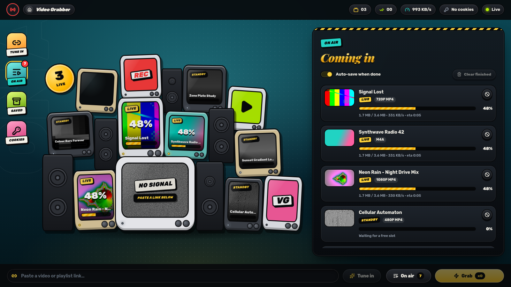
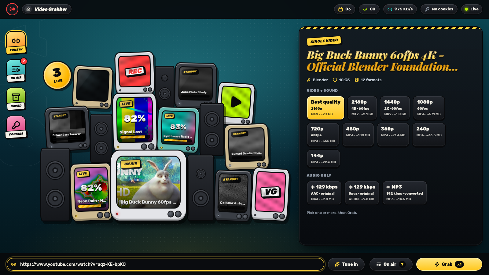
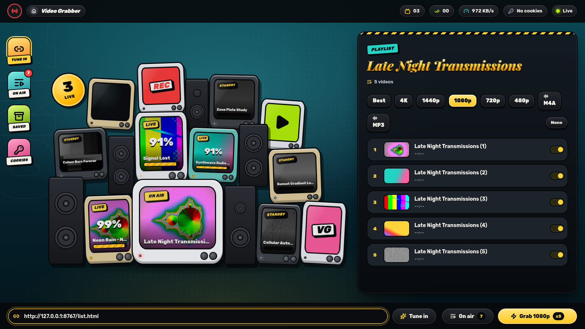
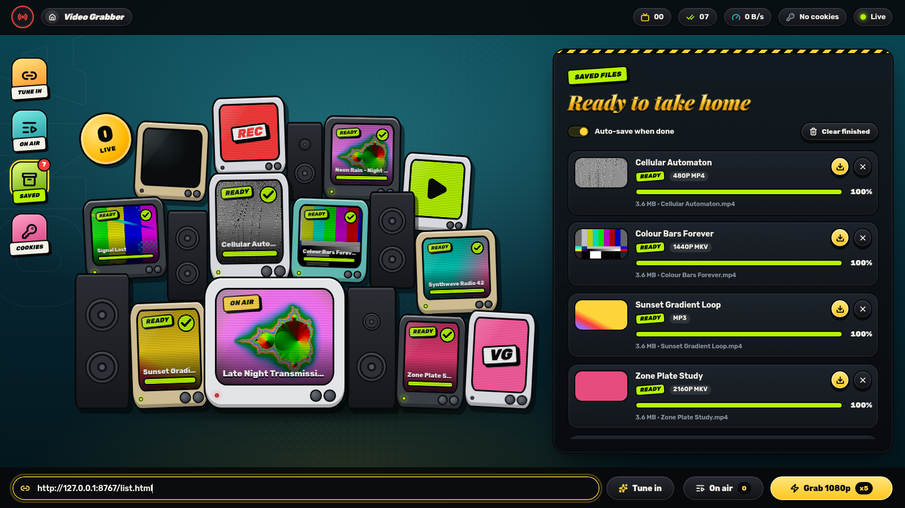
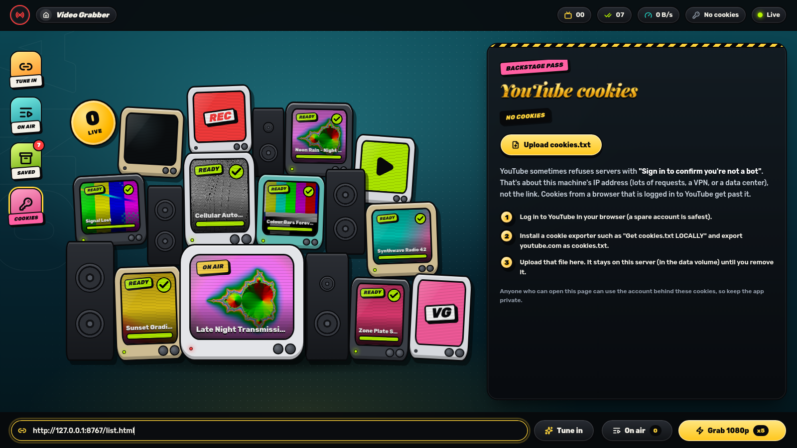
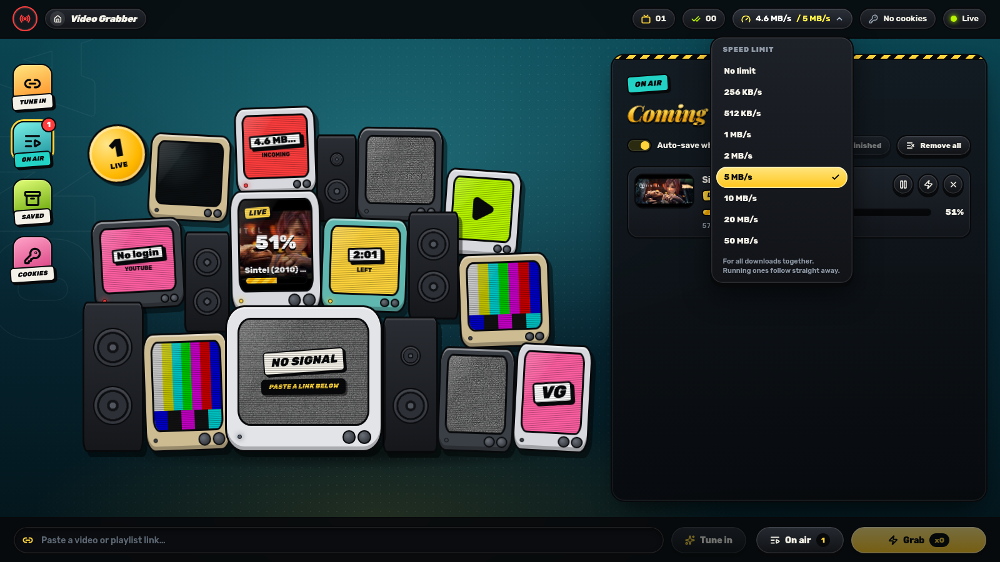
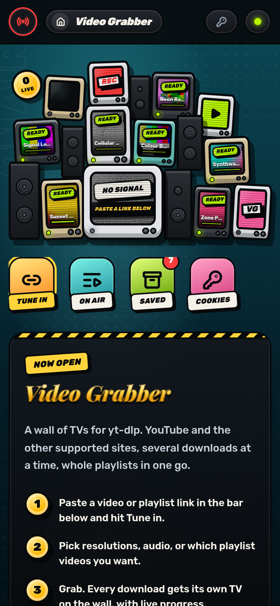
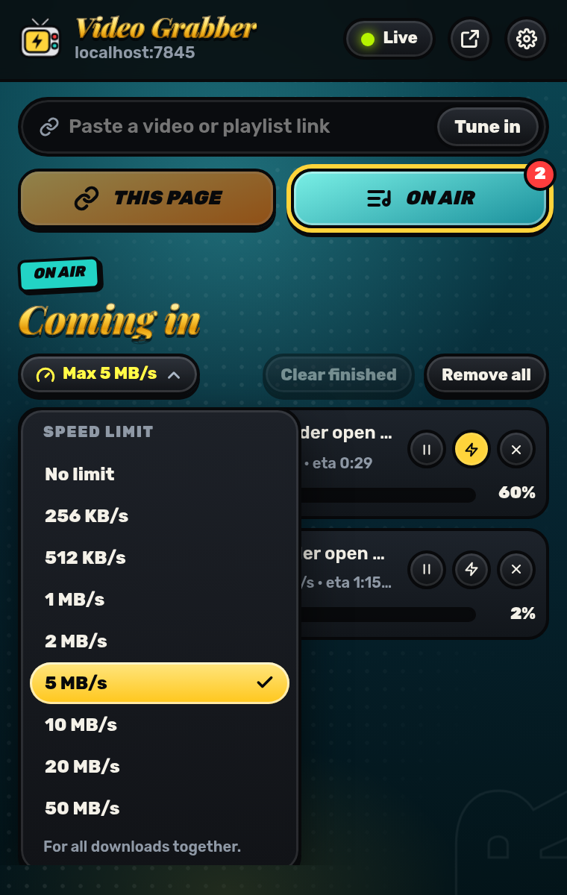
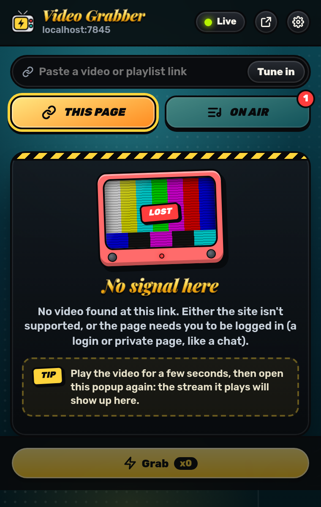
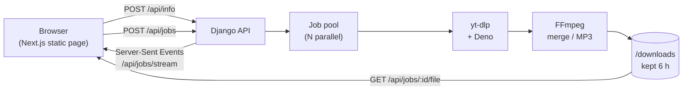

<div align="center">

# 📺 Video Grabber

### A wall of TVs for [yt-dlp](https://github.com/yt-dlp/yt-dlp)

Paste a video or playlist link, pick any quality (up to 4K) or audio only,
and watch every download come in live on its own TV.

[](https://hub.docker.com/r/sami999/video-grabber)
[](https://hub.docker.com/r/sami999/video-grabber/tags)
[](https://hub.docker.com/r/sami999/video-grabber/tags)
[](https://hub.docker.com/r/sami999/video-grabber)




</div>

---

## ⚡ Quick start

One container, one port. The image already has the frontend, the API, yt-dlp, FFmpeg and Deno.

```bash
docker run -d --name video-grabber -p 7845:7845 \
  -v video-grabber-data:/data \
  sami999/video-grabber:latest
```

Open **http://localhost:7845**, paste a link, hit **Tune in**, pick what you want and **Grab**.

> [!TIP]
> **7845** is used because almost nothing else claims it, unlike 8000, 8080 or 3000. To use
> another port, change the left side only: `-p 8080:7845` serves the app on
> http://localhost:8080 (and set the same address in the extension's settings).

<details>
<summary><b>Docker Compose</b></summary>

```yaml
services:
  video-grabber:
    image: sami999/video-grabber:latest
    ports:
      - "7845:7845"
    environment:
      MAX_PARALLEL_DOWNLOADS: 4   # 0 = all at once
    volumes:
      - data:/data   # uploaded YouTube cookies survive restarts
    restart: unless-stopped

volumes:
  data:
```

```bash
docker compose up -d
```

</details>

## ✨ Features

| | |
|---|---|
| 🎚️ **Every quality** | Each resolution the site offers, from 144p to 4K/8K, marked with 60fps / HDR, the container you'll get (MP4, or MKV when the codecs need it) and an estimated size |
| 🎧 **Audio only** | Original AAC (M4A) or Opus, or converted to MP3 at 192 kbps |
| 📼 **Playlists** | Lists every video with thumbnails; tick the ones you want, pick one quality cap for all of them and queue them in one go |
| 📡 **Live progress** | Server-Sent Events push percent, size, speed, ETA, which stream (video, then audio) and the merge / convert step |
| 🔀 **Parallel downloads** | Four downloads run at a time and the rest wait their turn (`MAX_PARALLEL_DOWNLOADS`). ⚡ Prioritize one and the others slow down so it finishes first. Pause and resume, cancel, retry or remove any of them |
| 🐢 **Speed limit** | Cap how fast all downloads together may go (from the speed pill in the top bar or the extension), so the rest of the network stays usable; running downloads follow a change straight away |
| 💾 **Straight to disk** | Finished files go to the browser's own download manager (auto-save is optional); nothing is held in browser memory |
| 🌐 **Almost any site** | ~1,800 sites by name through yt-dlp; with the extension, also the video a page is playing on any other site (MP4, HLS, DASH), fetched with that page's headers and, if you allow it, your login for that site |
| 🍪 **YouTube-proof** | When YouTube says *"confirm you're not a bot"*, the extension has already handed your YouTube login to the server (or you upload a `cookies.txt`); it's only used when the site insists, so it never costs you quality |
| 📱 **Works on phones** | The whole station folds down to a single column |

## 🖼️ Screenshots

<table>
  <tr>
    <td width="50%"></td>
    <td width="50%"></td>
  </tr>
  <tr>
    <td align="center"><b>Pick any quality</b><br><sub>4K, 1440p, 1080p… or audio only</sub></td>
    <td align="center"><b>Whole playlists</b><br><sub>choose videos, one quality cap, Grab ×N</sub></td>
  </tr>
  <tr>
    <td width="50%"></td>
    <td width="50%"></td>
  </tr>
  <tr>
    <td align="center"><b>Saved files</b><br><sub>every TV turns green when it's ready</sub></td>
    <td align="center"><b>Cookies</b><br><sub>get past YouTube's bot check</sub></td>
  </tr>
</table>

<p align="center">
  
  <br><b>Speed limit</b><br><sub>click the total speed in the top bar; running downloads follow straight away</sub>
</p>

<p align="center">
  
</p>

## 🧩 Browser extension

Grab straight from the page you're watching. The extension in [`extension/`](extension/) talks to
your server: its popup lists every quality for the current tab, queues downloads and shows their
progress live. A right-click menu, a badge counting active downloads, notifications and auto-save
to your Downloads folder come with it.

On sites the server doesn't know, turn on **Detect videos on any site** in the extension's
settings: while a page plays, the popup lists the file or stream it loads under **Playing on this
page**, ready to grab. DRM-protected services (Netflix, Spotify…) stay out of reach by design.

<table>
  <tr>
    <td align="center" width="33%"></td>
    <td align="center" width="33%"></td>
    <td align="center" width="33%"></td>
  </tr>
  <tr>
    <td align="center"><b>Any quality</b><br><sub>reads the tab you're on</sub></td>
    <td align="center"><b>Playlists &amp; Mixes</b><br><sub>one quality, Grab ×N</sub></td>
    <td align="center"><b>On air</b><br><sub>pause, ⚡ prioritize, remove</sub></td>
  </tr>
  <tr>
    <td align="center"></td>
    <td align="center"></td>
    <td align="center"></td>
  </tr>
  <tr>
    <td align="center"><b>Speed limit</b><br><sub>for all downloads together</sub></td>
    <td align="center"><b>No signal</b><br><sub>says why, and what to try</sub></td>
    <td align="center"><b>Any site</b><br><sub>grabs what the page is playing</sub></td>
  </tr>
  <tr>
    <td align="center"></td>
    <td align="center" colspan="2"></td>
  </tr>
  <tr>
    <td align="center"><b>Server off</b><br><sub>start command, reconnects by itself</sub></td>
    <td align="center" colspan="2"><b>Settings</b><br><sub>port quick picks, YouTube login, any-site switches</sub></td>
  </tr>
</table>

**Chrome / Edge / Brave:** `chrome://extensions` → Developer mode → **Load unpacked** → pick
`extension/release/chrome`. **Firefox:** `about:debugging` → **Load Temporary Add-on** → pick
`extension/release/firefox/manifest.json`. Details in [extension/README.md](extension/README.md).

## 🧠 How it works



- **Lookup**: `/api/info/` asks yt-dlp what a link offers, without downloading. Choices are
  heights (`h1080`), not format ids, so a download still works if YouTube hands out a different
  client's formats a minute later.
- **Jobs**: each choice becomes a job in an in-memory pool. yt-dlp's progress hooks update it, and
  every change goes out to all open tabs over one event stream.
- **Files**: video and audio streams are merged by FFmpeg (MP3 is converted), served once finished
  and deleted after `JOB_TTL_HOURS`.
- **Pacing**: polite mode limits and spaces each site's downloads (see below).
- **YouTube**: requests go out without cookies first. Only if YouTube demands a signed-in user is
  the request repeated with your cookies. A job that comes out below the chosen resolution says so.

## ⚙️ Configuration

Pass with `-e NAME=value` (or `environment:` in Compose).

| Variable | Default | What it does |
|---|---|---|
| `MAX_PARALLEL_DOWNLOADS` | `4` | Downloads that run at the same time, the rest wait (priority first); `0` starts them all at once, which takes a lot of memory for a big playlist |
| `SPEED_LIMIT_KBPS` | `0` | Starting total speed limit for all downloads in KB/s (`0` = none); once it's changed from the page or the extension, that setting (saved in `DATA_DIR`) wins |
| `BACKGROUND_KBPS` | `256` | While one download has priority (⚡ button), every other one is held to this speed in KB/s; `0` leaves them alone |
| `POLITE_MODE` | `1` | Pace traffic per site (below); `0` turns it off |
| `PER_SITE_PARALLEL` | `0` | Most downloads from one site at once, in polite mode; `0` is no limit |
| `START_GAP_MIN` / `START_GAP_MAX` | `1` / `3` | Random seconds between starting downloads from one site |
| `FORCE_IPV4` | `1` | Connect over IPv4 only; Docker networks rarely route IPv6, which shows up as "Network is unreachable". `0` allows IPv6 |
| `REQUEST_SLEEP` | `1` | Seconds yt-dlp waits between its own requests |
| `FRAGMENT_PARALLEL` | `8` | Pieces of an HLS/DASH video fetched at once; higher is faster, `1` is one at a time |
| `HTTP_CHUNK_MB` | `10` | Plain files are fetched in chunks of this size, which gets past per-request throttling; `0` turns it off |
| `READ_KB` | `128` | Size of each read from a download; small reads keep a speed limit steady instead of bursting |
| `INFO_CACHE_MINUTES` | `10` | How long a link lookup is reused instead of asked again |
| `JOB_TTL_HOURS` | `6` | How long finished files stay on the server |
| `ALLOWED_HOSTS` | `*` | Comma-separated host names the app answers to |
| `SECRET_KEY` | built-in fallback | Django secret key (nothing signs with it today, set it anyway) |
| `DATA_DIR` | `/data` | Where uploaded cookies live; mount a volume here |
| `DOWNLOAD_DIR` | `/downloads` | Where jobs write their files (emptied on start) |
| `COOKIES_FILE` | unset | A mounted `cookies.txt` to use when none was uploaded |
| `WEB_THREADS` | `32` | Gunicorn threads; each open tab holds one for its live stream |
| `TIME_ZONE` / `LANGUAGE_CODE` | `UTC` / `en-us` | Django localisation |

> [!NOTE]
> Jobs live in memory, so the app runs as a single Gunicorn process. Restarting the container
> clears the queue and the finished files (uploaded cookies stay in `/data`).

## 🐢 Polite mode (on by default)

Sites block addresses that send bursts of requests, so the server paces itself: a random 1–3 s gap
between starting downloads from one site (a prioritized one skips it), a 1 s pause between yt-dlp's own
requests, lookups reused for 10 minutes, and a longer random wait before retrying a refused stream.
A 50-video playlist ramps up over a minute or two instead of hitting the site in one go; set
`PER_SITE_PARALLEL` and a wider `START_GAP_*` if a site still pushes back. Nothing can promise a site
will never block you, but this keeps the traffic looking like a person rather than a bot.

## 🍪 YouTube says "Sign in to confirm you're not a bot"

YouTube says that to IP addresses it distrusts: servers, VPNs, or lots of requests in a short time.
It's about the address, not the link, and it often lifts after a while. The server gets past it
with your YouTube login (and only uses it when YouTube insists). Two ways to give it one:

**Automatic, with the [browser extension](extension/)** (recommended)

1. Log in to YouTube in your browser (a spare account is safest).
2. That's it: the extension sends the login to the server by itself, right after it's installed,
   before every YouTube lookup, every 6 hours and a minute after you log in or out. Only
   youtube.com cookies are read. The same login also opens your history, feeds and private
   playlists. Turn it off in **Settings → YouTube login**.

**Manual**

1. Export your youtube.com cookies as `cookies.txt` with an extension such as
   **Get cookies.txt LOCALLY**.
2. In the app, open **Cookies** and upload the file.

Either way the top bar shows **Cookies on**, and the Cookies tab says where they came from and when.

> [!WARNING]
> The app has no login. Anyone who can open the page can queue downloads and use the account
> behind the cookies. Keep it on your own machine or network, or put it behind a proxy with
> authentication.

## 🔌 API

Base URL `/api`, JSON bodies.

| Method | Path | Body | Does |
|---|---|---|---|
| `GET` | `/status/` | | `{ max_parallel, cookies, speed_limit_kbps }` |
| `GET` · `POST` | `/settings/` | `{ speed_limit_kbps }` | The total download speed limit in KB/s (`0` = none); applies to running downloads at once and is kept across restarts |
| `POST` | `/info/` | `{ url, start? }` | Video formats, or playlist entries (`kind` says which). Endless lists (YouTube history and feeds, Mixes) come 100 at a time: pass the returned `next_start` as `start` for the next page |
| `GET` | `/jobs/` | | All jobs |
| `POST` | `/jobs/` | `{ items: [{ url, format_id, label?, title?, thumbnail?, group?, headers?, cookies? }] }` | Queues one job per item |
| `GET` | `/jobs/stream/` | | Server-Sent Events: `{ jobs: [...] }` on every change |
| `POST` | `/jobs/:id/cancel/` | | Stops a job, keeps it listed |
| `POST` | `/jobs/:id/retry/` | | Replaces a failed or cancelled job |
| `POST` | `/jobs/:id/priority/` | `{ on? }` | Makes this the one download that goes first; the rest slow down (`on: false` undoes it) |
| `POST` | `/jobs/:id/pause/` · `/jobs/:id/resume/` | | Stops a download but keeps the partial file; resume continues from it |
| `DELETE` | `/jobs/:id/` | | Cancels if needed, removes the job and its file |
| `POST` | `/jobs/clear/` | | Removes finished, failed and cancelled jobs |
| `GET` | `/jobs/:id/file/` | | The finished file |
| `POST` / `DELETE` | `/cookies/` | multipart `file`, or `{ content, origin? }` | Stores / forgets the server's `cookies.txt` (`origin: "extension"` when the extension syncs a login) |

`headers` (only `Referer`, `Origin`, `User-Agent`) and `cookies` (the text of a cookies.txt) are
optional and also accepted by `/info/`; the extension uses them for videos found on a page. The
cookies are used for that one request or job and never stored, listed or logged.

`format_id`: `best`, an exact height from `/info/` (`h2160`, `h1080`…), a cap for playlists
(`1080p`), `audio` (M4A), `audio-opus`, `audio-mp3`, or any raw yt-dlp format selector.

<details>
<summary><b>Example: queue a 1080p download and an MP3 from the command line</b></summary>

```bash
curl -X POST http://localhost:7845/api/jobs/ -H 'Content-Type: application/json' -d '{
  "items": [
    { "url": "https://www.youtube.com/watch?v=aqz-KE-bpKQ", "format_id": "h1080" },
    { "url": "https://www.youtube.com/watch?v=aqz-KE-bpKQ", "format_id": "audio-mp3" }
  ]
}'
curl -N http://localhost:7845/api/jobs/stream/   # watch them come in
```

</details>

## 🛠️ Development

**Needs:** Python 3.11, FFmpeg, [Deno](https://deno.com) (yt-dlp uses it for YouTube), Node.js 20+
and pnpm.

```bash
# API on :8000
cd backend
python -m venv .venv && source .venv/bin/activate
pip install -r requirements.txt
python manage.py runserver 8000

# UI on :3000 (talks to the API on :8000; override with NEXT_PUBLIC_API_BASE)
cd frontend
pnpm install
pnpm dev
```

`pnpm build` writes a static export to `frontend/out`, which Django serves at `/` (that's how the
image works). Build the image yourself with `docker build -t video-grabber .`; add `--no-cache`
to pick up the newest yt-dlp.

<details>
<summary><b>Project structure</b></summary>

```text
backend/
├── apps/downloader/
│   ├── jobs.py           # job pool: progress, cancel, retry, cleanup
│   ├── services.py       # /info/: formats and playlist entries
│   ├── ytdlp.py          # yt-dlp runner, cookies (upload + fallback)
│   └── views.py, urls.py
├── common/               # errors, logging helpers
└── config/settings/      # split settings, dev / prod, WhiteNoise for the UI
frontend/
├── src/app/page.tsx      # the station
├── src/app/wall.css      # TVs, speakers, stickers, pills
├── src/components/wall/  # TvWall, TopBar, SideRail, panels, BottomBar
├── src/hooks/use-jobs.ts # live job list (Server-Sent Events)
└── src/lib/api.ts
extension/                # browser extension: src/, release/chrome, release/firefox
Dockerfile                # Node builds the UI, Python + FFmpeg + Deno run it all
docker-compose.yml
```

</details>

## 🙏 Credits

- [yt-dlp](https://github.com/yt-dlp/yt-dlp) does the real work; [FFmpeg](https://ffmpeg.org)
  merges and converts; [Deno](https://deno.com) runs YouTube's JavaScript for yt-dlp.
- The video in the screenshots is *Big Buck Bunny* © Blender Foundation,
  [CC BY 3.0](https://creativecommons.org/licenses/by/3.0/). The other thumbnails are generated
  FFmpeg test patterns.

> Only download what you have the right to download, and respect the terms of the sites you use.
