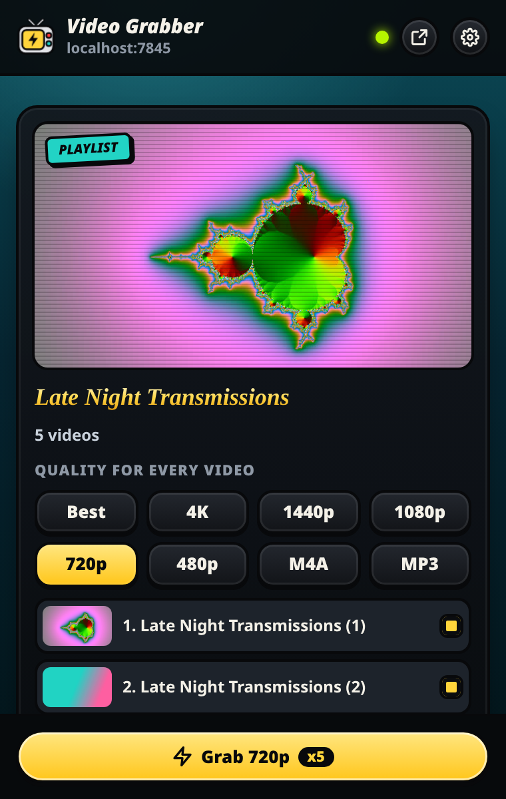
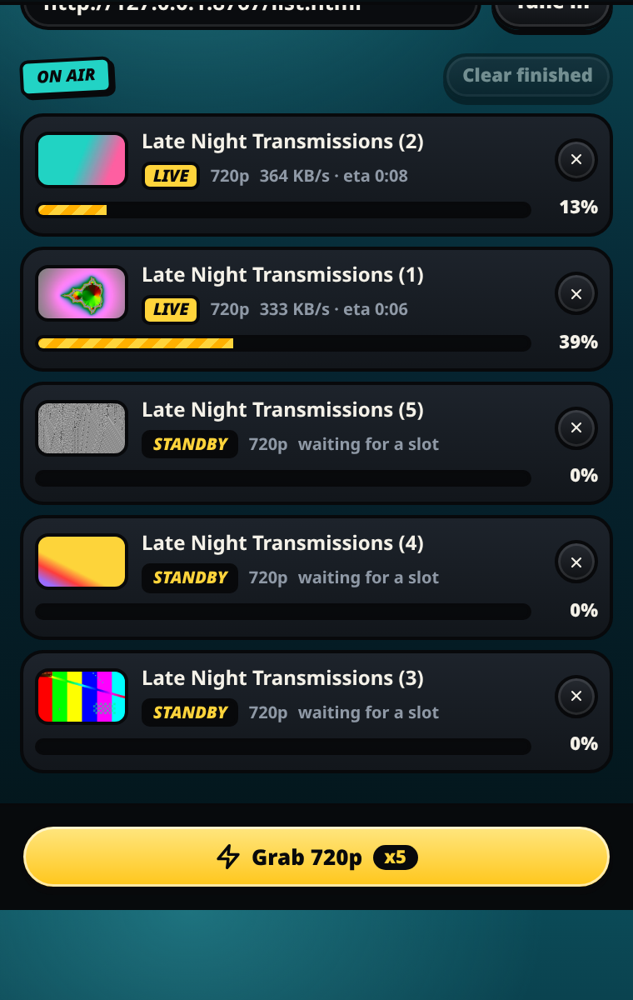
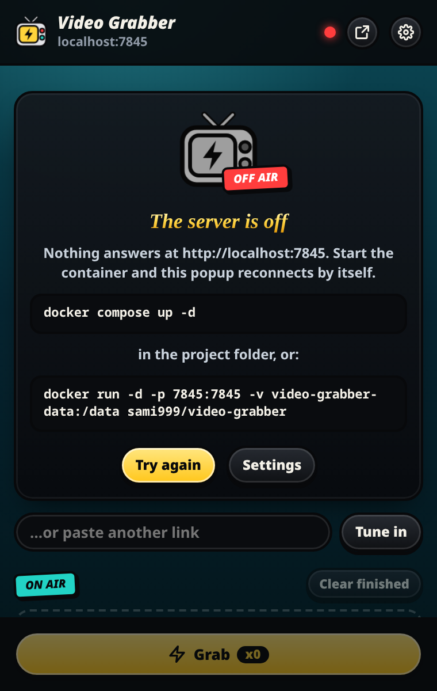
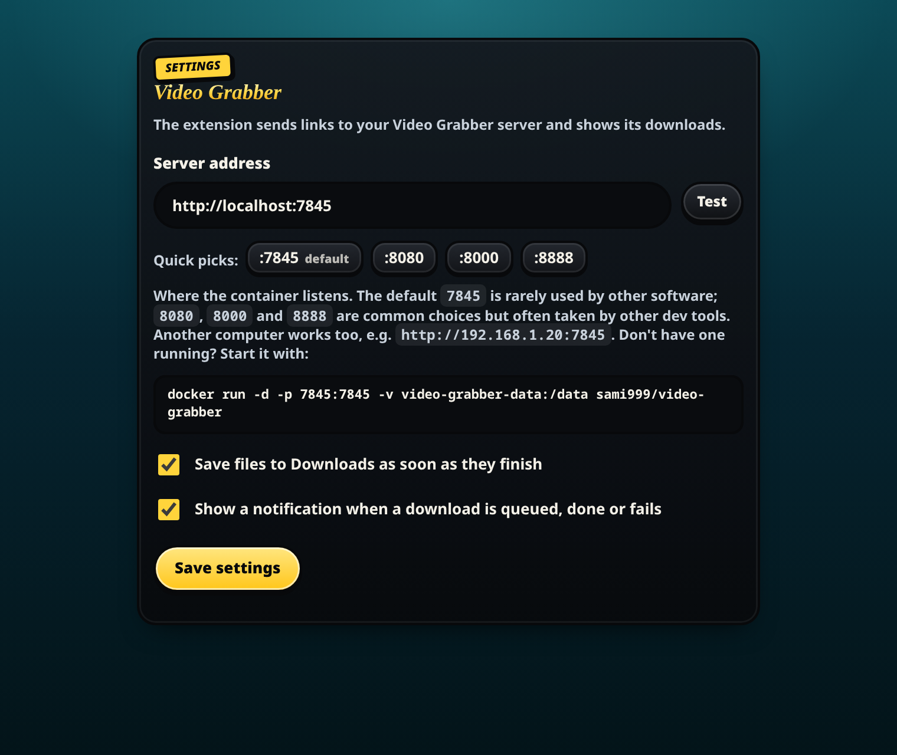
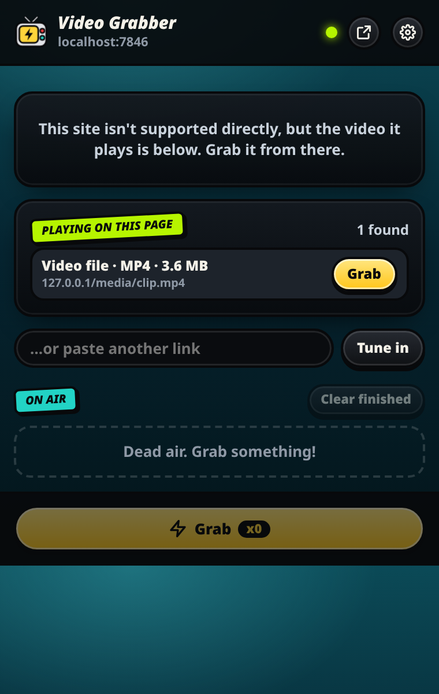

# Video Grabber browser extension

A remote control for your [Video Grabber](../README.md) server. Open a video or playlist, click the
toolbar button, pick a quality (or audio only) and **Grab**; the popup shows every download's
progress live. Works in Chrome, Edge, Brave, Opera and Firefox.

<p>
  
  
  
</p>
<p>
  
  
</p>

## What it does

- **Popup**: reads the page you're on and lists every quality the server finds (4K to 144p, 60fps/HDR,
  MP4/MKV, sizes) plus M4A, Opus and MP3. Playlists show their videos with one quality for all.
- **Live progress**: speed, time left, merge/convert step; save, cancel or retry from the list.
- **Speed limit**: cap all downloads together from the Downloads tab (the server keeps the setting).
- **Right-click menu**: *Grab with Video Grabber → Best / 1080p / 720p / M4A / MP3* on any page or link.
- **Badge and notifications**: the toolbar shows how many downloads are running; you get a
  notification when one is ready or fails.
- **Auto-save**: downloads you start from the extension go straight to your Downloads folder.
- **Any site** (opt-in): the video file or stream (MP4, HLS, DASH) a page plays shows up under
  *Playing on this page*, even on sites the server doesn't know.
- **YouTube login**: keeps the server on your YouTube login by itself, so your history, feeds,
  private playlists and YouTube's "confirm you're not a bot" check just work. No cookies.txt
  export needed.

The video is downloaded by the server (yt-dlp, FFmpeg), not by the browser, so YouTube's split
streams and signed URLs are handled the same way as in the web app.

## Install

You need a running server first:

```bash
docker run -d -p 7845:7845 -v video-grabber-data:/data sami999/video-grabber
```

### Chrome, Edge, Brave, Opera

1. Open `chrome://extensions` (`edge://extensions` in Edge).
2. Turn on **Developer mode**.
3. Click **Load unpacked** and choose the **`extension/release/chrome`** folder.
4. Pin **Video Grabber** to the toolbar.

> The Chrome Web Store doesn't accept YouTube downloaders, so the extension is installed this way.

### Firefox (128 or newer)

- **Try it**: open `about:debugging#/runtime/this-firefox` → **Load Temporary Add-on…** → pick
  **`extension/release/firefox/manifest.json`**. It stays until Firefox restarts.
- **Keep it**: zip the contents of `release/firefox` and sign it on
  [addons.mozilla.org](https://addons.mozilla.org/developers/) (self-distributed / unlisted is
  fine), then install the signed `.xpi`.
- Firefox asks before an extension may talk to a site: open the popup and click **Allow access**.

## Settings

Right-click the toolbar button → **Options** (or the gear in the popup):

| Setting | Default | |
|---|---|---|
| Server address | `http://localhost:7845` | Quick picks for 7845, 8080, 8000 and 8888; any address works, e.g. `http://192.168.1.20:7845` (the browser asks once for permission) |
| Save files when done | on | Sends finished downloads to your Downloads folder |
| Notifications | on | Queued / ready / failed |
| YouTube login: keep up to date | on | See [YouTube login](#youtube-login) |
| Detect videos on any site | off | See [Any website](#any-website) |
| Send my login with downloads | off | See [Any website](#any-website) |

## YouTube login

Your history, feeds, private playlists and YouTube's *"sign in to confirm you're not a bot"* check
need a YouTube login on the server. The extension takes care of it: it reads your youtube.com
cookies (nothing else), checks you're logged in, and stores them on the server, in the same place a
manual cookies.txt upload goes. It does that right after it's installed, before every YouTube
lookup (YouTube rotates login cookies often), every 6 hours, and a minute after you log in or out.
**Settings → YouTube login**:

- **Keep it up to date automatically** is on by default; turn it off to keep your login off the
  server.
- **Send my YouTube login now** sends it on the spot.
- When a link hits YouTube's bot check, the popup shows a **Send my YouTube login** button that does
  it in one click and tries the link again.

The server only uses the login when YouTube insists. A spare account is safest. To remove it, use
**Remove** in the station's Cookies tab. The manual way (upload a cookies.txt there) still works.

## Any website

The server recognises about 1,800 sites by name. For everything else, Settings has two switches,
both off until you turn them on:

| Switch | What it does |
|---|---|
| **Detect videos playing on any site** | Lets the extension see the video files and streams a page loads (it asks the browser for access to all sites). Play the video for a moment, open the popup, and grab it from *Playing on this page*; streams also have **Qualities**. Pieces of streams, tiny clips (previews, ads) and YouTube's own servers are left out. Nothing leaves the browser until you press Grab |
| **Send my login for that site with each download** | For videos that only play while you're logged in. Your cookies for that one site go to your server with the download, are used for it and deleted straight after; never stored, listed or logged. Only use it with a server you run yourself |

The page's address goes along as `Referer`, because many sites refuse video requests that don't
come from their own page. DRM-protected services (Netflix, Prime Video, Disney+, Spotify) can't be
downloaded: their video is encrypted, and breaking that is illegal in most countries.

<p></p>

## Notes

- The server has no login. Point the extension at a server on your own machine or network.
- "Sign in to confirm you're not a bot" comes from YouTube; upload cookies in the station's
  **Cookies** tab.
- Chrome wakes the extension's background at most every 30 seconds, so with the popup closed,
  auto-save and notifications can lag by up to half a minute. With the popup open they're instant.

## Files

| Path | |
|---|---|
| `release/chrome/` | Ready to load in Chrome, Edge, Brave, Opera |
| `release/firefox/` | Ready to load in Firefox |
| `src/` | The source both are built from |
| `src/manifest.base.json` | Shared manifest (Manifest V3); `build.mjs` adds each browser's background setup |
| `src/popup.*` | The toolbar popup |
| `src/background.js` | Right-click menu, badge, notifications, auto-save |
| `src/options.*` | Server address and switches |
| `src/shared.js` | Settings, API calls, formatting |
| `src/icons/` | `icon.svg` and the PNG sizes made from it |

After changing anything in `src/`, run `node build.mjs` (no dependencies) to refresh both release
folders, and commit them.
